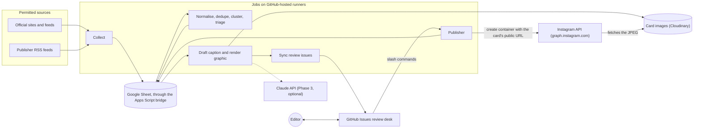
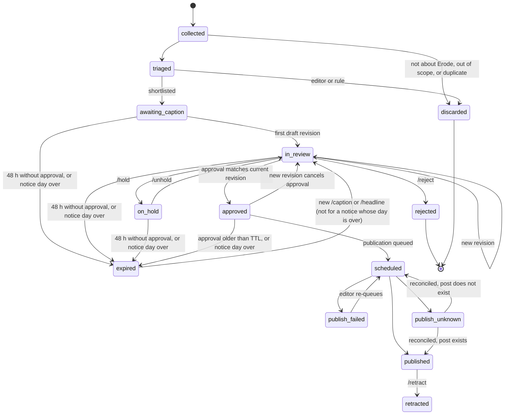

# Architecture

> **Status, 2026-10-31:** most of this design is implemented, tested and pushed; the Google Sheet, its bridge and Cloudinary are set up, and manual collect and draft runs work. Not live (no `LIVE` file); nothing has been posted. Storage moved from the Supabase plan to a Google Sheet with an Apps Script bridge and Cloudinary images, at the owner's request (same as Coimbatore 360). Not implemented yet: `maintenance.yml`, backups, the editor-tip form, the Claude drafter (Phase 3) and an editor override for the near-duplicate guard.
> Where a detail depends on an external service, the document says what was checked and what still needs verification.

## 1. Design drivers

- **Safety before speed.** A wrong post about a crime, a death or a named person can cause real harm. Every irreversible step is gated, logged and reversible where possible.
- **No always-on servers.** Work runs as short jobs on GitHub-hosted runners. No inbound endpoints (no webhooks) are exposed, which keeps the attack surface small.
- **Low cost.** Free tiers only until the owner approves otherwise. Each paid component sits behind an interface and is optional.
- **Portability.** All business logic lives in `src/` and runs through plain commands (`pnpm run job:<name>`). GitHub Actions only schedules and triggers them, so a different scheduler can replace it without code changes (see risk R1 in the [project plan](../PROJECT_PLAN.md#7-risks-and-mitigations)).
- **Auditability.** Every source, decision, approval and API call is recorded in the `ErodeGlitz Newsroom` Google Sheet.

## 2. System context



Editors can also submit tips by opening an issue from a template; a tip enters the pipeline as a source item of type `editor_tip` and needs the same verification as anything else.

## 3. Execution model

Each workflow runs `node src/jobs/<name>.ts` (the same command as `pnpm run job:<name>`, without starting pnpm). The split into collect, draft and publish follows the Coimbatore 360 pattern the owner asked for (2026-10-30); [Workflows](WORKFLOWS.md) explains what was adopted from it and what was deliberately changed, with schedules and costs.

| Workflow | Trigger | Runner | What it does | Concurrency group |
|---|---|---|---|---|
| `ci.yml` | push, pull request | `ubuntu-latest` | Frozen-lockfile install, typecheck, lint, test (including render tests) | per ref, cancel in progress |
| `collect.yml` | every 2 h, 06:07 to 22:07 IST; manual (dry run by default) | `ubuntu-slim` | Fetch approved sources, store new items; start `draft.yml` when something is new | `collect`, no cancel |
| `draft.yml` | from `collect.yml` and `review-command.yml`; safety net every 4 h | check job `ubuntu-slim`; render job `ubuntu-latest` until the runner spike passes | Cluster, triage, template caption, render, open or update review issues | `draft`, no cancel |
| `review-command.yml` | `issue_comment` (created), with a job-level `if` so only comments starting with `/` from owners, members or collaborators start a runner | `ubuntu-slim` | Parse and authorise the command, record the decision, start `draft.yml` or `publish.yml` | `review-<issue number>` |
| `publish.yml` | from an approval when `PUBLISH_ON_APPROVAL` is `true`; catch-up every 2 h, 08:47 to 20:47 IST; manual (dry run by default) | `ubuntu-slim` | Publish one due item | `publisher`, no cancel |
| `collect-switch.yml` | manual | `ubuntu-slim` | Pause or start automatic collecting and drafting (Coimbatore 360's collect-switch; a Sheet switch) | `collect-switch` |
| `status.yml` | daily 07:13 IST; manual | `ubuntu-slim` | Read-only health report | `status` |
| `token-refresh.yml` | Mondays 03:17 IST; manual | `ubuntu-slim` | Refresh the long-lived Instagram token | `token` |
| `import-token.yml` | manual only (Phase 2) | `ubuntu-slim` | Owner-only import of a token from a temporary secret, after read-only checks (`/me` and the publishing quota); stored encrypted | `token` |
| `maintenance.yml` | daily schedule; manual (Phase 1) | `ubuntu-slim` | Retention clean-up, daily digest; weekly encrypted backup export | `maintenance` |
| `migrate.yml` | manual only | `ubuntu-slim` | Create the Sheet's tabs and columns and run the Sheets self test. Other jobs check the layout version and refuse to run on a mismatch. | `migrate` |

`maintenance.yml` is not written yet.

Facts this relies on, from GitHub's documentation (checked 2026-10-29):

- Cron schedules run in UTC unless a per-entry IANA `timezone` is given, for example `timezone: "Asia/Kolkata"`. The shortest interval is 5 minutes.
- Scheduled runs use the latest commit on the default branch. They can be delayed at high load, especially at the start of each hour, and some queued jobs may be dropped. Hence the off-the-hour minutes and the idempotent design.
- `issue_comment` workflows run the workflow file from the default branch.
- Events created with the repository's `GITHUB_TOKEN` do not start new workflow runs, except `workflow_dispatch` and `repository_dispatch`. So the bot's own comments never trigger `review-command.yml`, and `review-command.yml` can start `publish.yml` with `workflow_dispatch` (needs `actions: write`).
- With the default concurrency queue, at most one run is pending per group and a newer pending run replaces the older one. Each publisher run drains every due item, so a replaced pending run loses nothing.
- `ubuntu-slim` is a 1-vCPU, 5 GB RAM, container-based runner with a 15-minute job timeout (generally available since 2026-01-22). Whether headless Chromium renders reliably there is a Phase 0 spike.

Each job also sets `timeout-minutes`, and requests only the `permissions` it needs. For example, `pipeline.yml` gets `contents: read` and `issues: write`; `ci.yml` gets `contents: read` only.

## 4. Story lifecycle



All transitions are implemented as pure functions, `transition(story, event) -> Result<Story, TransitionError>`, with exhaustive `switch` statements, and persisted with optimistic concurrency (a `version` column). An event that is invalid for the current state is rejected and recorded, never silently applied.

## 5. Pipeline stages

### 5.1 Source registry and permitted collection

Sources are declared in a typed, version-controlled registry (`config/sources.ts`) and mirrored into the `sources` table. Each entry carries:

- `id`, `name`, `kind` (`rss`, `atom`, `sitemap`, `listing_page`, `editor_tip`), `url`, `trustTier` (`T1_official`, `T2_established_publisher`, `T3_other`)
- `termsReview`: `status` (`pending`, `approved`, `rejected`), reviewer, date, notes, `allowedUse` (`discovery_only` or `facts_with_attribution`; image reuse is never allowed by default), and `llmInputAllowed` (default `false`; some publishers, such as Dinamalar, signal in robots.txt that they object to AI use)
- `robots`: last checked, result
- `fetchIntervalMinutes`, `enabled`

Collector rules:

- The collector refuses to fetch a source unless `termsReview.status === "approved"`, the review is less than 180 days old, and robots.txt permits the path.
- One request for each source's feed or page per run, with conditional GET (`ETag`, `Last-Modified`), timeouts, and backoff on HTTP 429 and 503. Listing pages add one request per new article (next rule).
- The User-Agent identifies the bot and a contact, for example `ErodeGlitzBot/0.1 (+contact URL)`.
- No login-walled or paywalled content. No social-media scraping of any kind.
- Only metadata and a short excerpt (at most 500 characters) are stored. Full articles are never stored or republished.
- Listing pages give no dates, so the collector opens each new article once (robots.txt permitting, at most 15 a run, 1.5 seconds apart) and reads only its publication time (`article:published_time` or JSON-LD `datePublished`). An article whose date cannot be read is not stored, so an old story on a listing page never passes as today's news. Coimbatore 360 also opens each article.

### 5.2 Normalisation

- Unicode NFC; remove zero-width joiner and non-joiner characters for comparison only (never in published text); convert Tamil digits (௦ to ௯) to ASCII digits; collapse whitespace; standard punctuation.
- Canonical URLs: lower-case host, strip tracking parameters (`utm_*`, `fbclid` and similar), drop fragments, then hash with SHA-256.
- Grapheme segmentation with `Intl.Segmenter`, because a Tamil syllable is often two code points (consonant plus vowel sign).

### 5.3 Duplicate detection and story clustering

1. **Exact:** unique `(source_id, url_hash)`, plus a content hash of the normalised title and excerpt.
2. **Near-duplicate:** MinHash signatures over grapheme 3-grams with LSH banding. Initial thresholds, to be tuned on labelled Phase 1 data: Jaccard ≥ 0.55 within ±2 days merges into the same story; 0.35 to 0.55 is shown to the editor as "possible duplicate".
3. **Cross-language** (an English and a Tamil report of the same event) is left to the editor in the MVP. Embeddings or an AI "same event?" hint may come later, as a hint only.
4. **Published-post guard:** before publishing, the draft is compared with everything published in the last 7 days. A match blocks publication unless the editor overrides it explicitly.

Each story keeps all its source items in `story_sources`, which also feeds corroboration counts.

### 5.4 Relevance to Erode

A gazetteer (`config/gazetteer.ts`) lists Tamil and English names for Erode city, the district's taluks and major towns (see the [editorial policy](EDITORIAL_POLICY.md#1-mission-and-coverage-area)). Items from Erode-specific sources pass. Items from state or national sources need a gazetteer match in the title or excerpt.

English matching is case-sensitive and context-aware, because "erode" is also an ordinary English verb. Tamil ஈரோடு is unambiguous.

### 5.5 Risk classification

```ts
type RiskTier = "R0_ROUTINE" | "R1_STANDARD" | "R2_SENSITIVE";

type RiskFlag = {
  category: SensitiveCategory; // e.g. "crime", "death", "minor", "communal", "election"
  origin: "rule" | "ai" | "editor";
  detail: string;
};
```

- Keyword and pattern rules in Tamil and English assign categories. Categories map to tiers as defined in the [editorial policy](EDITORIAL_POLICY.md#5-risk-tiers-and-sensitive-categories).
- The final tier is the maximum of the rule, AI and editor tiers. AI can only raise it.
- An editor may lower a tier only with a recorded reason, for example a keyword false positive.
- Conflicting sources set a `disputed` flag, which forces `R2_SENSITIVE`.
- If classification fails for any reason, the story is treated as `R2_SENSITIVE`.

### 5.6 Verification model

```ts
type VerificationLevel =
  | "V0_UNVERIFIED"       // one non-official source
  | "V1_CORROBORATED"     // two or more independent credible sources
  | "V2_OFFICIAL"         // primary official source fetched from the official domain
  | "V3_EDITOR_ATTESTED"; // an editor verified it and recorded how

type VerificationEvidence =
  | { kind: "official_source"; sourceItemId: SourceItemId }
  | { kind: "independent_corroboration"; sourceItemIds: readonly [SourceItemId, SourceItemId, ...SourceItemId[]] }
  | { kind: "editor_attestation"; editorLogin: GitHubLogin; method: string; attestedAt: IsoDateTime };
// Deliberately no "ai" variant. Model output can create RiskFlags; it can never create evidence.
```

- The verification level is **derived** from evidence rows; it is never stored as a free-form field that something could set directly.
- "Independent" means different organisations. Syndicated copies of the same wire report count once.
- Each evidence row is parsed with the evidence schema on read, so a row must reference either source items or an editor login, matching its kind.
- The minimum level per risk tier is defined in the [editorial policy](EDITORIAL_POLICY.md#4-verification-levels).

### 5.7 Captions

`CaptionDrafter` is an interface with three implementations:

1. `manual`: an editor writes the caption with a `/caption` comment. This is the Phase 1 default.
2. `template`: deterministic templates for structured official notices, such as power-shutdown schedules.
3. `anthropic` (Phase 3): Claude via `@anthropic-ai/sdk`, using `client.messages.parse()` with `zodOutputFormat()` from `@anthropic-ai/sdk/helpers/zod`.
   - Default model `claude-opus-5-5`. Thinking cannot be disabled on that model; set `output_config.effort` explicitly, because its default is `medium`.
   - Handle `stop_reason: "refusal"`, and enable server-side fallbacks.
   - The input is the **fact sheet** (structured facts, each with source references), never raw article text. Text from a source with `llmInputAllowed: false` is never sent; facts from such a source enter the fact sheet only after an editor restates or confirms them. The model has no tools.

Every caption, whatever its origin, passes the same validators:

- Zod schema: `headlineTa`, `captionTa`, `hashtags`, `sourceCreditTa`, `altText`, `factIdsUsed`.
- Instagram limits: caption at most 2,200 characters, at most 30 hashtags, at most 20 @-mentions, alt text at most 1,000 characters. House policy is stricter: at most 5 hashtags, no @-mentions of individuals, and a caption budget of about 1,800 characters for safety.
- Tamil-script share of letters at least 60%.
- Every number, date and proper name in the caption must appear in the fact sheet.
- Banned phrases (clickbait, guilt language before conviction), no URLs.

If the LLM fails or the budget is used up, the story falls back to `manual`. The pipeline never blocks on the LLM.

LLM calls are cached by `sha256(model, promptVersion, factSheet)` so a rerun does not pay twice.

### 5.8 Graphics

- HTML/CSS templates (`news-card`, `alert-card`, `correction-card`) rendered by headless Chromium through Playwright at 1080×1350 (4:5) and exported as JPEG, sRGB, quality around 85, typically well under 1 MB. Instagram allows at most 8 MB, aspect ratios from 4:5 to 1.91:1, and widths from 320 to 1440 px.
- Fonts are bundled from `assets/fonts` (Noto Sans Tamil and Noto Serif Tamil under the SIL Open Font License, with the licence file). Rendering never depends on system fonts.
- Text fitting runs in the page: the font size steps down until the headline fits within its line limit. If it still does not fit, validation fails and the editor shortens the headline.
- No third-party photos. No AI-generated imagery. Brand elements: ErodeGlitz wordmark, place tag, Tamil date, source credit.
- The object key is `renders/<yyyy>/<mm>/<sha256>.jpg`, computed from the template version and inputs, ASCII only. Meta's documentation warns that non-ASCII URLs can fail.

### 5.9 Editorial review desk (GitHub Issues)

One issue per story, found again by a hidden marker in the body: `<!-- erodeglitz:story=<id> -->`. The body is regenerated on each new revision:

```text
<!-- erodeglitz:story=01JC... -->
## <Tamil headline>
Risk: R2_SENSITIVE (crime, named person) | Verification: V1_CORROBORATED | Revision 3 | rev a1b2c3d4e5f6

### Caption (revision 3)
...

### Sources
1. Source name, URL, published 2026-10-29 09:12 IST, tier T2, primary
2. ...

### Checks
- Caption 812/1800 characters, 4 hashtags, 0 mentions
- Possible duplicates: none

### Preview


### Commands
/approve-sensitive a1b2c3d4e5f6   /caption (with text)   /attest <how you verified>   /hold <reason>   /reject <reason>
```

Commands:

| Command | Effect |
|---|---|
| `/caption` followed by text | Creates a new revision. The graphic is re-rendered; earlier approvals no longer apply. |
| `/headline <text>` | New revision with a new headline |
| `/approve <rev>` | Approves revision `<rev>` of an R0 or R1 story |
| `/approve-sensitive <rev>` | Required for R2 or disputed stories; plain `/approve` is refused for them |
| `/schedule <rev> <HH:MM>` | Approve and publish at a time (IST) inside the posting window |
| `/attest <method>` | Records editor verification evidence (for example, "Confirmed with Erode Town police station by phone, 10:40 IST") |
| `/hold <reason>`, `/unhold` | Pause or resume |
| `/reject <reason>` | Final rejection |
| `/retract <reason>` | Records a retraction for a published story; the owner deletes or edits the post (API deletion is a Phase 4 option) |
| `/killswitch on <reason>`, `/killswitch off` | Stop or resume all publishing. Anyone in the editor list can switch it on; only the owner can switch it off. |

Authorisation and safety:

- The commenter's login must be in `EDITOR_GITHUB_LOGINS`, and `author_association` must be `OWNER`, `MEMBER` or `COLLABORATOR`.
- An approval binds to the **revision hash**, which is SHA-256 over the canonical JSON of story ID, revision number, headline, caption, hashtags, alt text, template version, render SHA-256 and source list. Editors type the first 12 hex characters; the full hash is stored.
- Approvals expire after `APPROVAL_TTL_HOURS` (default 12), so stale news needs a fresh look.
- Stories expire when they wait 48 hours without approval (counted from arrival or from the editor's latest command), or when a notice's stated day is over (`src/review/expiry.ts`). Every `draft` run, including the cheap scheduled check, expires them with one Sheet write, notes why on the issue, and closes it as "not planned". A new `/caption` or `/headline` on an expired story brings it back to review and reopens the issue; commands that lead to a post are refused for a notice whose day is over.
- Comment bodies are untrusted input. Workflows pass them to the TypeScript parser through an environment variable and never interpolate `${{ github.event.comment.body }}` into a shell script, which would allow script injection.
- Each processed comment ID is stored with a unique constraint, so a redelivered event cannot create a second decision.

The repository is **public** (owner decision, 2026-10-31), so standard Actions runners are free, and the issues are public too. Therefore no newspaper text goes into issue titles, issue bodies or run summaries: an issue names each source and links to it, and the editor reads the story there (`test/public-safety.test.ts`). Everything typed into an issue is public, including `/caption` drafts of stories that are later rejected.

### 5.10 Publishing

Instagram API with Instagram Login, host `graph.instagram.com`, pinned Graph API version (`v26.0`, the latest when checked; introduced 2026-07-29). Flow, from Meta's content publishing guide:

1. `POST /<IG_ID>/media` with `image_url`, `caption` and `alt_text` returns a container ID.
2. `GET /<CONTAINER_ID>?fields=status_code` returns `IN_PROGRESS`, `FINISHED`, `ERROR`, `EXPIRED` or `PUBLISHED`. Meta suggests polling about once a minute for no more than 5 minutes.
3. `POST /<IG_ID>/media_publish` with `creation_id` returns the media ID.
4. `GET /<MEDIA_ID>?fields=permalink` for the record.

Gates, all evaluated before container creation **and again immediately before `media_publish`**:

1. Switches (§7): the `LIVE` file exists, the repository variable `PAUSED` is not `true`, the Sheet's `kill_switch` is off, and this is not a dry run.
2. An approval exists for the exact current revision hash, is not superseded, is younger than the TTL, and came from an allowlisted editor. R2 stories need `/approve-sensitive`.
3. The verification level meets the minimum for the risk tier.
4. The validation report passes; the JPEG's SHA-256 matches the approved render.
5. The story has not been published already, it is not a notice whose stated day is over, and no near-duplicate was published in the last 7 days unless an editor overrode the check.
6. Inside the posting window; minimum spacing since the previous post; under the daily cap; the live `content_publishing_limit` shows headroom.
7. A token exists, is not expired, and the last health check passed.

Algorithm (one publication per run, to respect spacing):

```text
claim one due publication with a lease (UPDATE ... WHERE lease expired ... RETURNING)
run gates; on failure record the reason, release the lease, stop
if no usable container (none, EXPIRED or ERROR):
    public Cloudinary URL of the render (named by a SHA-256 of the card's template version and text)
    record attempt "create_container"; call POST /media; store container id
poll status (about every 60 s, at most 5 min); IN_PROGRESS -> retry in a later run
if status == PUBLISHED -> reconcile (find the media id) and stop
re-check gate 1 (kill switch)
mark publication "publish_requested" and commit BEFORE the call
call POST /media_publish
  success           -> store media id and permalink -> "published"
  ambiguous failure -> "publish_unknown" -> reconcile
  definite failure  -> classify (see below)
```

Reconciliation uses the container as Meta's own idempotency key. A container can be published only once:

- Container status `PUBLISHED` means the post exists. Find it with `GET /<IG_ID>/media?fields=id,caption,timestamp,permalink` by matching the caption hash and a timestamp after the request.
- `FINISHED` means it was not published, so a retry with the same container is safe.
- `EXPIRED` or `ERROR` means a new container is needed, and a human checks first.

`media_publish` is never retried while the outcome is unknown.

Error classification (codes from Meta's error reference):

| Class | Examples | Action |
|---|---|---|
| Transient | subcode 2207001 (server error), 2207003 (download timeout), 24/2207008, 9007/2207027 (not ready), HTTP 5xx, network errors before the request was sent | Retry with exponential backoff (`next_attempt_at`), at most 5 attempts, then `publish_failed` and an alert |
| New container needed | 24/2207006, -2/2207020 (expired), -1/2207032 | Create a new container (still subject to the gates) |
| Fix required | 9004/2207052 (URL not fetchable), 36000/2207004 (image too large), 36001/2207005 (format), 36003/2207009 (aspect ratio), 36004/2207010 (caption too long), 100/2207040 (too many @-tags) | `publish_failed`, alert; a bug in our validation, so add a test |
| Quota | 9/2207042 | Reschedule after the rolling window; alert if unexpected |
| Account or authentication | 4/2207051 (spam restriction), 25/2207050 (account restricted), OAuth/token errors | **Trip the kill switch**, alert the owner |
| Ambiguous | timeout or connection reset after the publish request was sent | `publish_unknown`, then reconcile |

## 6. Data model

Owner decision, 2026-10-30: storage is a Google Sheet, as in Coimbatore 360 (it replaces the earlier Supabase plan). The `ErodeGlitz Newsroom` Sheet lives in the `erodeglitz@gmail.com` Google account and has one tab per table; row 1 holds the column names. The layout is defined in `src/sheet/tables.ts` and created by the `migrate` workflow.

Jobs reach the Sheet only through the Apps Script bridge (`apps-script/Code.gs`), a web app bound to the Sheet:

- Every request is a POST whose body carries the key (`BRIDGE_KEY` in Script properties). Apps Script cannot read request headers, and the key is never put in the URL.
- Every request holds the script lock, so "insert if absent", compare-and-set updates and publication leases are atomic even when two workflows run at once.
- The bridge knows no news logic. It offers `select`, `insert` (with a unique key and an optional "refuse if" rule), `upsert`, compare-and-set `update` (with order and limit, used for leases), `batch`, and secrets in Script properties. Nothing is ever deleted.
- Tabs marked append-only (`decisions`, `evidence`, `drafts`, `publish_attempts`, `errors`) refuse `update` and `upsert`.
- Every cell is written as plain text, and text that Sheets would read as a formula (`=`, `+`, `-`, `@`, `'`) is stored literally, so a headline or a source title can never become a formula. The `migrate` workflow checks this against the real Sheet with a self test.
- Retries are safe: inserts carry their own id, and a row with the same id is recognised as the client's own earlier request whose answer was lost.

Cells are text: timestamps are UTC ISO strings (`Date.toISOString()`, one fixed length, so they compare correctly as text), lists are JSON, booleans are `true` / `false`, and an empty cell means "not set". IDs are UUIDv7, generated in the application. Every row is parsed with the domain's Zod schemas when it is read, so a bad hand edit is reported with its tab and row instead of reaching the publisher.

| Tab | Columns | Rules |
|---|---|---|
| `settings` | key, enabled, reason, updated_by, updated_at | Holds `collecting_enabled` (collect-switch) and `kill_switch` (`/killswitch`). A missing row means off: collecting paused, kill switch not pulled. A value other than exactly `true` or `false` counts as the safe state: collecting paused, kill switch on. |
| `sources` | id, name, kind, url, trust_tier, erode_specific, terms_status, terms_reviewed_by, terms_reviewed_at, terms_notes, allowed_use, llm_input_allowed, link_pattern, fetch_interval_minutes, enabled, etag, last_modified, last_fetched_at, consecutive_failures, updated_at | Mirror of `src/config/sources.ts`; registry columns are overwritten each run, fetch state is kept |
| `source_items` | id, source_id, canonical_url, url_hash, title, excerpt (≤ 500 chars), language, published_at, fetched_at, content_hash, story_id | unique (source_id, url_hash) |
| `story_sources` | story_id, source_item_id, relation (`primary`, `corroborating`, `contradicting`), created_at | unique (story_id, source_item_id) |
| `stories` | id, status, version, topic, place_tags, risk_tier, risk_flags, disputed, priority, first_seen_at, updated_at, expires_at | updates are compare-and-set on `version` |
| `evidence` | id, story_id, kind, source_item_ids, editor_login, method, attested_at, created_at | append-only; no AI kind exists |
| `drafts` | id, story_id, revision, revision_hash, headline_ta, caption_ta, hashtags, alt_text, source_credit_ta, template_version, render_key, render_sha256, origin, created_at | append-only; one row per (story_id, revision) |
| `decisions` | id, story_id, kind, editor_login, github_comment_id, revision_hash, reason, scheduled_for, created_at | append-only; unique (github_comment_id) |
| `review_threads` | story_id, issue_number, last_synced_revision, updated_at | one row per story |
| `publications` | id, story_id, draft_id, idempotency_key, status, scheduled_for, attempts, container_id, container_created_at, publish_requested_at, media_id, permalink, next_attempt_at, lease_owner, lease_expires_at, published_at, last_error, created_at, updated_at | unique (idempotency_key); at most one live publication per story; leases taken and saved under the script lock |
| `publish_attempts` | id, publication_id, step, outcome, http_status, error_code, error_subcode, is_transient, detail (redacted), created_at | append-only |
| `job_runs` | id, workflow, run_id, git_sha, started_at, finished_at, status, counters | |
| `errors` | id, job_run_id, stage, entity_type, entity_id, error_class, code, message (redacted), retryable, created_at | append-only |

The Instagram token is not in any tab. It is encrypted with AES-256-GCM (key `TOKEN_ENCRYPTION_KEY`, held only in GitHub) and stored in the bridge's Script properties under `SECRET_instagram_token`, with its expiry readable for alerts.

Card images are on Cloudinary under `<CLOUDINARY_FOLDER>/renders/<yyyy>/<mm>/<sha256>`. Uploads are signed with the API secret and never overwrite.

`idempotency_key = sha256(story_id + revision_hash + ig_user_id)`.

Known limits of a Sheet compared with a database: anyone who can edit the Sheet (only the owner) can change history by hand; the bridge's append-only rule cannot stop that. A batch of operations is not a transaction: an error stops it midway. Each call takes about 1–2 seconds. Up to 10 million cells per Sheet.

## 7. Kill switch

Publishing requires **all** of the following. The first two are Coimbatore 360's switches ([Workflows §4](WORKFLOWS.md#4-switches)).

1. A file named `LIVE` is in the repository root. `publish.yml` checks it before anything else runs, and the publisher checks it again.
2. The repository variable `PAUSED` is not `true`. The workflow checks it in an `if:`, so a paused schedule starts no runner.
3. The Sheet's `kill_switch` (`settings` tab) is off, read fresh before container creation and again before `media_publish`.
4. The run is not a dry run. Manual runs are dry runs unless the box is unticked; the code defaults to dry run when `DRY_RUN` is missing.

Ways to stop publishing:

- An editor comments `/killswitch on <reason>` on any issue. This works from a phone.
- Remove the `LIVE` file, or set the repository variable `PAUSED` to `true`.
- `gh workflow disable publish.yml`.
- Last resort: revoke the token or remove the app's access in Instagram or Meta settings.

The system turns the kill switch on automatically on authentication or token errors, a spam or restriction error, two unresolved `publish_unknown` states, an impossible daily count, or a detected duplicate post. Only the owner can switch it off. The procedure is in the [operations runbook](OPERATIONS.md#4-kill-switch).

## 8. Idempotency and retries by stage

| Stage | Guard | On failure |
|---|---|---|
| Fetch | unique (source_id, url_hash), enforced by the bridge under its lock; conditional GET | Retry next run. After 6 consecutive failures, disable the source and raise an alert. |
| Normalise, cluster, triage | Deterministic functions; upserts; optimistic `version` | Safe to rerun |
| LLM draft | Cache by input hash; at most 2 attempts | Fall back to manual caption |
| Render | Content-addressed object key | Safe to rerun |
| Review issue | `review_threads` row plus hidden marker searched before creating | Safe to rerun; a crash between creating the issue and saving the row is recovered by the marker search |
| Editorial decision | unique `github_comment_id` | Duplicate events ignored |
| Container creation | Stored container ID, reused while `FINISHED` and less than 24 h old | New container only after `EXPIRED` or `ERROR` |
| `media_publish` | Container status checked before any retry; `PUBLISHED` means never call again | Ambiguous outcome becomes `publish_unknown` and is reconciled |
| Token refresh | Weekly schedule with a workflow concurrency group; the token must be at least 24 h old | Retry next day; alert when fewer than 14 days remain |

## 9. Security

### Secrets inventory

| Secret | Where it lives | Used by | Rotation |
|---|---|---|---|
| `SHEET_BRIDGE_URL` (Apps Script web app URL) and `SHEET_BRIDGE_KEY` (the bridge's `BRIDGE_KEY`) | GitHub repository secrets; the key also in the bridge's Script properties | all jobs | on suspicion; yearly (new key in Script properties, then the secret) |
| `CLOUDINARY_API_KEY` and `CLOUDINARY_API_SECRET` | GitHub repository secrets | render, publish | on suspicion; yearly |
| `TOKEN_ENCRYPTION_KEY` (32 random bytes, base64) | GitHub repository secret | token import, refresh, publish | yearly; `key_version` allows rolling |
| Instagram long-lived token | Bridge Script properties, encrypted | publish, refresh | refreshed weekly (valid 60 days) |
| `IG_BOOTSTRAP_TOKEN` | Temporary GitHub secret, deleted right after import | `import-token.yml` | single use |
| `ANTHROPIC_API_KEY` (Phase 3) | GitHub repository secret | draft | on suspicion |

Environment-scoped secrets would be better, but GitHub Free does not offer them for private repositories, so repository secrets are used and every workflow requests minimal permissions.

### Controls

- Sheet: not shared with anyone; the Google account has two-factor authentication; the bridge's `@OnlyCurrentDoc` annotation limits it to this one Sheet (`spreadsheets.currentonly`); every request needs the key; the bridge never deletes rows and refuses changes to append-only tabs.
- Card images are public on Cloudinary at URLs named by a SHA-256 of the card's template version and text, so they cannot be guessed without the exact card text. The URLs appear in the review issue, which is public, and in the request to Meta, so anyone reading an issue can see the card of a story that is not approved yet. Uploads are signed; there is no unsigned upload preset.
- The token is sent in a header where Meta supports it (to be verified in Phase 2), never in a logged URL. A logger redaction list covers `access_token`, `Authorization`, `apikey`, `password` and secret names.
- `GITHUB_TOKEN` permissions are declared per workflow. There are no `pull_request_target` workflows. Untrusted text reaches scripts only through environment variables.
- Supply chain: `pnpm install --frozen-lockfile`; build scripts only for allowlisted packages; a minimum release age for new package versions if pnpm 11 supports it (verify in Phase 0); actions pinned to full commit SHAs; Dependabot.
- Prompt injection: source text is untrusted. The model only drafts from a structured fact sheet, has no tools, and its output is schema-checked, fact-checked and human-approved.
- One inbound endpoint: the Apps Script bridge, protected by its key. No other inbound endpoints.

## 10. Cost controls (technical)

- Workflow schedules sized to the minutes budget ([Operations §9](OPERATIONS.md#9-cost-monitoring-and-budgets)); `ubuntu-slim` where it works; the runner's own Node.js, production dependencies and the Playwright browser restored from the Actions cache; bulk Sheet reads and writes, so a job's Sheet calls do not grow with the number of open stories; the Chromium step runs only when something needs rendering; job-level `if` filters so non-command comments never start a runner.
- `timeout-minutes` on every job.
- LLM (Phase 3): drafts only for shortlisted stories; at most 3 LLM revisions per story; a daily item cap; a monthly USD cap computed from `llm_usage`; prompt caching for the stable system prompt; the Batch API (50% cheaper) for anything not urgent; a Console spend limit as the final backstop.
- Storage: the Sheet's 10 million cells last many years at this volume; a retention job (still to write) can archive old rows. Cloudinary Free plan limits are checked on its pricing page during setup.

## 11. Code organisation and coding standards

```text
.github/workflows/      ci, pipeline, review-command, publish, token-refresh, import-token, maintenance
.github/ISSUE_TEMPLATE/ tip, incident
assets/fonts/           OFL Tamil fonts and licence
config/                 sources.ts, gazetteer.ts, sensitivity-rules.ts, hashtags.ts
apps-script/            the Sheet bridge (Code.gs), pasted into Apps Script by the owner
src/
  domain/               types, schemas, state machines, verification and risk rules (pure, no I/O)
  config/               environment schema (Zod), fail-closed defaults
  collectors/           http client, robots, rss, sitemaps, listing pages
  pipeline/             normalise, minhash, cluster, relevance, triage
  captions/             drafter interface, manual, template, anthropic, validators, prompts
  graphics/             templates, renderer, text fitting
  review/               GitHub issue sync, command parser, authorisation
  publishing/           instagram client, gates, publisher, reconciler, error classification
  storage/              object store interface, Cloudinary implementation
  sheet/                bridge client, tab layout, stores (row mappers), setup and self test
  ops/                  kill switch, budgets, alerts, logger, run context, backup
  jobs/                 CLI entry points, one per job
test/                   fixtures, integration tests
```

Compiler settings (the starting point for Phase 0):

```jsonc
{
  "compilerOptions": {
    "target": "ES2024",
    "module": "NodeNext",
    "moduleResolution": "NodeNext",
    "strict": true,
    "exactOptionalPropertyTypes": true,
    "noUncheckedIndexedAccess": true,
    "noImplicitOverride": true,
    "noImplicitReturns": true,
    "noFallthroughCasesInSwitch": true,
    "noPropertyAccessFromIndexSignature": true,
    "useUnknownInCatchVariables": true,
    "verbatimModuleSyntax": true,
    "isolatedModules": true,
    "erasableSyntaxOnly": true,
    "forceConsistentCasingInFileNames": true,
    "skipLibCheck": true,
    "noEmit": true
  }
}
```

`erasableSyntaxOnly` rules out enums, namespaces and parameter properties, which fits "unions and `type` only". It also lets Node run the TypeScript sources directly with built-in type stripping, so jobs need no build step. This works on Node 24 (the workflows) and Node 22 (local tests) with every dependency; the fallback is a `tsc` build to `dist/`.

Rules:

- Domain types use `type`, never `interface`. ESLint enforces this with `@typescript-eslint/consistent-type-definitions: ["error", "type"]`.
- No `any`. Enforced by `@typescript-eslint/no-explicit-any` and the `no-unsafe-*` rules. External data enters as `unknown` and is parsed with Zod.
- Optional properties use Zod's `.exactOptional()`, so a key may be absent but is never explicitly `undefined`, matching `exactOptionalPropertyTypes`. Objects use `z.strictObject` at trust boundaries.
- Schemas are checked against the declared types:

  ```ts
  export type SourceItem = {
    id: SourceItemId;
    sourceId: SourceId;
    canonicalUrl: string;
    title: string;
    publishedAt?: IsoDateTime; // absent when the feed gives no date
  };

  export const SourceItemSchema = z.strictObject({
    id: SourceItemIdSchema,
    sourceId: SourceIdSchema,
    canonicalUrl: z.url(),
    title: z.string().min(1).max(500),
    publishedAt: IsoDateTimeSchema.exactOptional(),
  }) satisfies z.ZodType<SourceItem>;
  ```

- Expected failures are returned as discriminated unions (`{ ok: true; value } | { ok: false; error }`). Exceptions are for unexpected failures, caught at the job boundary and written to `errors`.
- `switch` statements over unions are exhaustive (`@typescript-eslint/switch-exhaustiveness-check`).

## 12. Testing strategy

- **Unit (Vitest):** state machines, gates, verification derivation, risk tiering, normalisation, MinHash and clustering, command parsing, caption validators, error classification, configuration defaults.
- **Integration:** the stores run against the real `apps-script/Code.gs` inside a Node `vm` with a fake Sheet that copies Sheets' text conversions (formulas, numbers, dates), including unique keys, append-only tabs and leases. The same contract tests run against the in-memory stores, and the end-to-end flow test runs on both.
- **Contract:** the Instagram client against recorded fixtures shaped like Meta's documented responses and errors, with the network mocked. Tests never call the real Instagram API.
- **Rendering:** smoke tests check dimensions, JPEG format, size limit and that fonts loaded. Pixel snapshots run only in CI, on a fixed runner image.
- **Safety invariants**, each with a dedicated test:
  - No Instagram write happens when any kill-switch layer is off, or when configuration is missing.
  - An approval of revision A can never publish revision B.
  - An expired approval cannot publish.
  - An ambiguous `media_publish` failure never leads to a second `media_publish` without reconciliation.
  - AI flags can never lower a risk tier, and there is no code path that creates evidence from AI output (checked at type level and at runtime).
  - An R2 story cannot be approved with plain `/approve`; a V0 story cannot be approved without `/attest`.
  - Commands from users outside the allowlist are ignored and recorded.
  - Secrets never appear in logged objects (redaction test).
- CI runs typecheck, lint and tests on every push and pull request. Coverage thresholds apply to `src/domain` and `src/publishing`.

## 13. Alternatives considered

| Topic | Chosen | Not chosen, and why |
|---|---|---|
| Instagram login type | Instagram Login | Facebook Login for Business needs a linked Facebook Page and Page token. Unified Login is recommended by Meta for new integrations and needs a business portfolio, but its system-user token setup was not documented on the pages checked; re-evaluate in Phase 2. |
| Review desk | GitHub Issues | Telegram (new account, polling); a web admin (needs hosting and authentication); editing the Sheet directly (no per-command audit trail, and easy to break on a phone) |
| Rendering | Chromium | SVG-to-image or canvas libraries need manual line breaking, and their Tamil shaping would have to be proven; Satori relies on opentype.js rather than HarfBuzz, which is a known risk for complex scripts (unverified for Tamil) |
| Storage | Google Sheet through an Apps Script bridge (owner decision, 2026-10-30, same as Coimbatore 360) | Supabase Postgres (the earlier plan: real transactions and constraints; replaced at the owner's request); committing state files to git (conflicts with concurrent runs) |
| Card images | Cloudinary (same as Coimbatore 360) | Google Drive links (Instagram often cannot fetch them); a public GitHub Pages repository (every card, including rejected ones, would be in a public git history) |
| Storage of the Instagram token | Encrypted, in the bridge's Script properties | Updating a GitHub secret from a workflow would need a personal access token with secret-write rights, another powerful long-lived credential |
